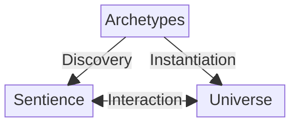
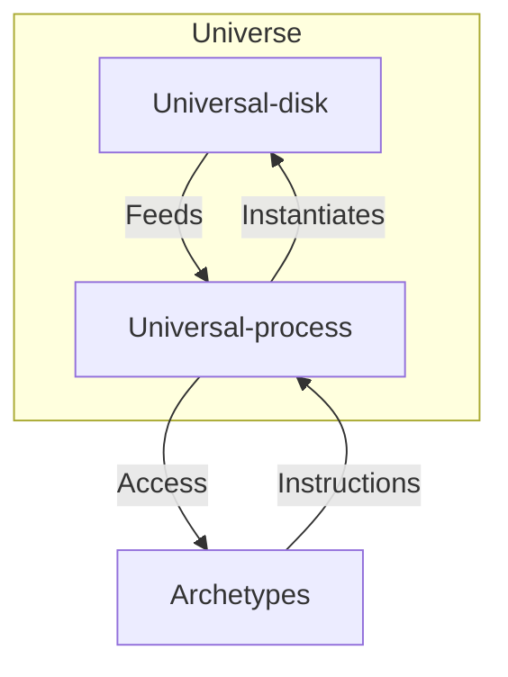
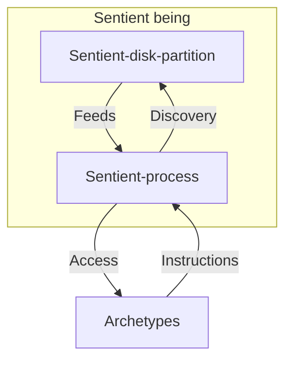
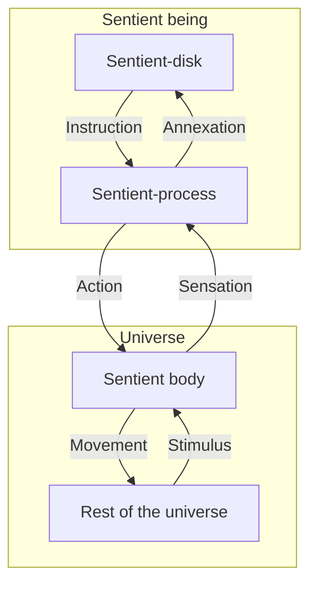
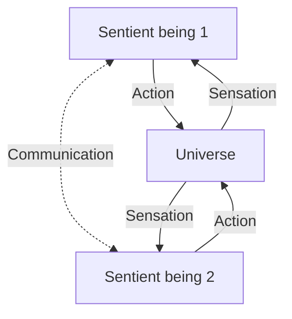

# Reality structure

## Simplified model

There are two kinds of interaction:
- Action: when the sentience transforms the universe (including its own body)
- Sensation: when the universe appends information to the sentience.

## Disks and processes
Imagine the whole reality is a computer.
It would require three kinds of disk:

| Disk type  | Permissions |
| ---------- | ----------- |
| Archetypal | Read-only   |
| Sentient   | Append-only |
| Universal  | Read-write  |

The Universal-disk is updated by the Universal-process.

Each sentient being is its own process.
Each sentient being would own a partition of the Sentient-disk, which would be private.

The Archetypal-disk, from here on called the Archetypes, has all instructions.
All the mathematical constants, all the physical constants and all the psychological constants.

The Archetypes have all the required instructions for the Universal-process and the Sentient-processes.

### Instantiation

The Universal-process reads from the Universal-disk, then reads the instructions in the Archetypes, then apply the transformation and finally writes the result on the Universal-disk.

### Discovery

Given the current state of a sentient being, the Archetypes contain the instructions to the next possible states.
Free will is the pointer that chooses the set of instructions to apply.

### Body, Sentience and the Universe

The Body, being part of the Universe, is the interface through which sentience both receives sensation from and acts upon the Universe.

### Communication between sentient beings

Given what was established so far, communication works the following way:

## Notes

### Note on Antoine Lavoisier
Lavoisier said:
> "Nothing is lost, nothing is created, everything is transformed."

This may apply to the Universal-disk.
But it does not apply to the Sentient-disk, which is in constant creation.
Nor does it apply to the Archetypes which are never transformed.

### Note on Roger Penrose
I developed this model independently, then later encountered Roger Penrose's account of the mathematical, physical, and mental worlds.
Although there are similarities, his account differs substantially from my view of reality.

### Note on Edward Fredkin
Edward Fredkin's digital physics treats physical processes as computational.
By contrast, I use computation only as a symbol for describing reality.
