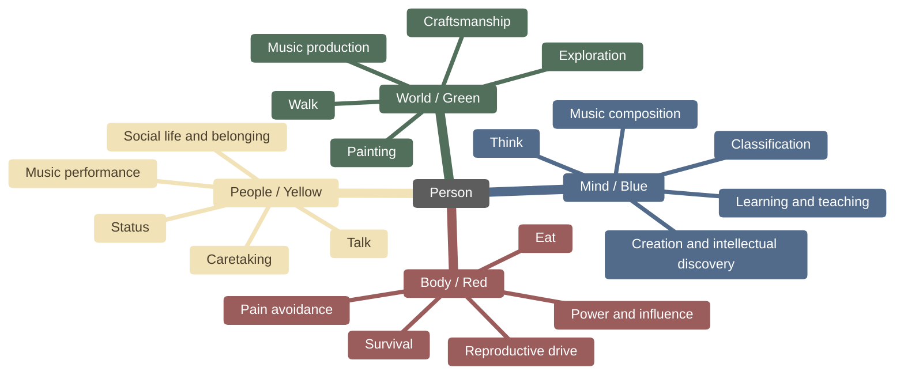
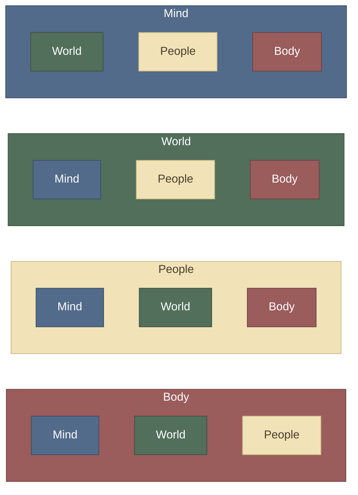
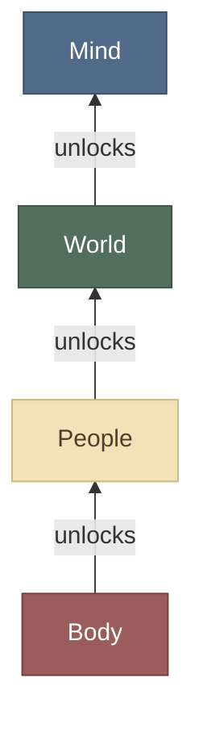
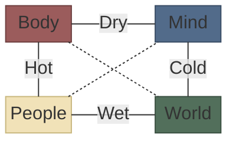

# Psychic auras

- What motivates people?
- How different can personal goals be?
- What people do with their free time?
- Given freedom, health and resources, what one focus on?
- Given that a person is functional, what makes them different from others?

## Auras and their symbolic activities

The activities listed are symbolic, i.e. meant to illustrate. They can be enjoyable for any type of person regardless of their aura type.

## Auras relation

Every aura contains the others as tools.

## Personality development stack

1. The bare minimum body control unlocks words usage.
2. The bare minimum social interaction unlocks knowledge on traversing the world both outward and inward.
3. The bare minimum first hand experience of the world unlocks abstraction interest, and the possibility of intellectual pursuits.

Access to the world is a condition to the autonomy of thought, otherwise people rely entirely on what they heard other people say. For instance if a scientific result can't be reproduced one must trust the initial data.

## Auras and temperaments

| Quality | Positive  | Negative |
| ------- | --------- | -------- |
| Hot     | energetic | restless |
| Cold    | composed  | inert    |
| Dry     | focused   | rigid    |
| Wet     | fluid     | diffuse  |

Therefore the most natural mapping would be the following:

| Aura   | Color  | Dryness | Heat | Humor       |
| ------ | ------ | ------- | ---- | ----------- |
| Mind   | Blue   | Dry     | Cold | Melancholic |
| World  | Green  | Wet     | Cold | Phlegmatic  |
| People | Yellow | Wet     | Hot  | Sanguine    |
| Body   | Red    | Dry     | Hot  | Choleric    |

Note that this mapping is more of an overlap than a perfect fit.

### Aura adjacencies given their qualities

The dashed lines show opposition, the continuous/labeled lines show adjacency.

Adjacency can also manifest as competition.
Opposition can also manifest as complementarity.
